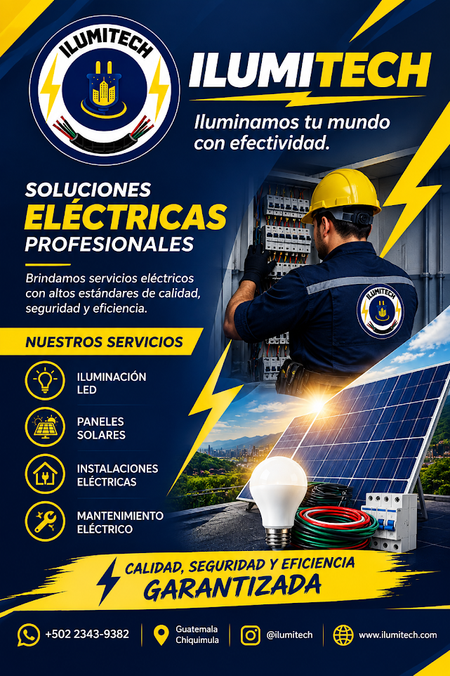
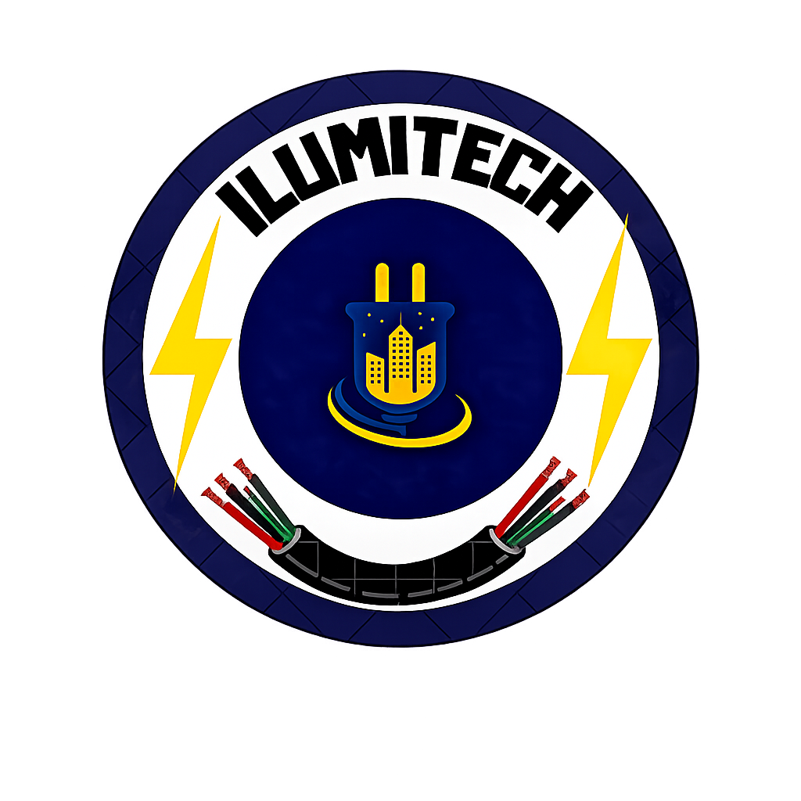

<!DOCTYPE html>
<html lang="es">
<head>
    <meta charset="UTF-8">
    <meta name="viewport" content="width=device-width, initial-scale=1.0">
    <title>Ilumitech | Soluciones Eléctricas Profesionales</title>
    
</head>
<body>

    <!-- 1. HERO (Banner Largo) -->
    <header>
        <h1>ILUMITECH</h1>
        
Iluminamos tu mundo con efectividad

    </header>

    <!-- 2. SPOTLIGHT (Banner Vertical/Flyer) -->
    <section class="promo-spotlight">
        

            
        

        

            <h2>Soluciones Profesionales</h2>
            
Brindamos servicios eléctricos con altos estándares de calidad, seguridad y eficiencia. ¡Calidad garantizada en cada conexión!

        

    </section>

    <!-- 3. SOBRE NOSOTROS -->
    <section id="nosotros">
        

            

                
            

            

                <h2 style="text-align: left; border-bottom: 4px solid var(--amarillo-ilumitech); width: fit-content;">¿Qué es Ilumitech?</h2>
                
Ilumitech es una empresa dedicada a ofrecer soluciones eléctricas y tecnología eficiente para hogares y negocios. Nuestro objetivo es brindar productos y servicios de calidad que ayuden a iluminar el futuro.

            

        

    </section>

    <!-- 4. SERVICIOS -->
    <section id="servicios">
        <h2 class="section-title">Nuestros Servicios</h2>
        

            
<h3>Iluminación LED</h3>
Ahorro y estilo para tu espacio.

            
<h3>Paneles Solares</h3>
Energía limpia y renovable.

            
<h3>Instalaciones</h3>
Seguridad en cada conexión.

            
<h3>Mantenimiento</h3>
Optimización de sistemas eléctricos.

        

    </section>

    <!-- 5. VIDEOS (CON 3 VIDEOS) -->
    <section id="videos">
        <h2 class="section-title">Nuestra Tecnología en Acción</h2>
        

            
            <!-- Video 1 -->
            

                <video controls>
                    <source src="video1.mp4" type="video/mp4">
                    Tu navegador no reproduce el elemento de video.
                </video>
                <h3>Instalaciones de Paneles Solares</h3>
            

            <!-- Video 2 -->
            

                <video controls>
                    <source src="video2.mp4" type="video/mp4">
                    Tu navegador no reproduce el elemento de video.
                </video>
                <h3>Mantenimiento de Redes Eléctricas</h3>
            

            <!-- Video 3 -->
            

                <video controls>
                    <source src="video3.mp4" type="video/mp4">
                    Tu navegador no reproduce el elemento de video.
                </video>
                <h3>Proyecto de Iluminación LED</h3>
            

        

    </section>

    <!-- 6. IMPORTANCIA -->
    <section id="importancia">
        

            <h2 style="color: var(--amarillo-ilumitech); border:none;">La importancia de la electricidad</h2>
            
La electricidad es fundamental en la vida diaria porque permite iluminar los hogares, utilizar aparatos eléctricos y facilitar el trabajo. Su uso responsable ayuda a ahorrar energía y proteger el ambiente.

        

    </section>

    <!-- 7. CONTACTO -->
    <section id="contacto">
        

            

                <h3>Escanea para contactar</h3>
                
            

            

                <h2>¿Listo para brillar?</h2>
                
Estamos en Guatemala, Chiquimula. Haz clic abajo y hablemos por WhatsApp de tu proyecto.

                <a href="https://wa.me/50223439382?text=Hola%20Ilumitech,%20deseo%20más%20información" class="btn-whatsapp">
                    💬 Chatear con un experto
                </a>
            

        

    </section>

    <footer>
        
&copy; 2023 ILUMITECH - Calidad, Seguridad y Eficiencia Garantizada

    </footer>

</body>
</html>
